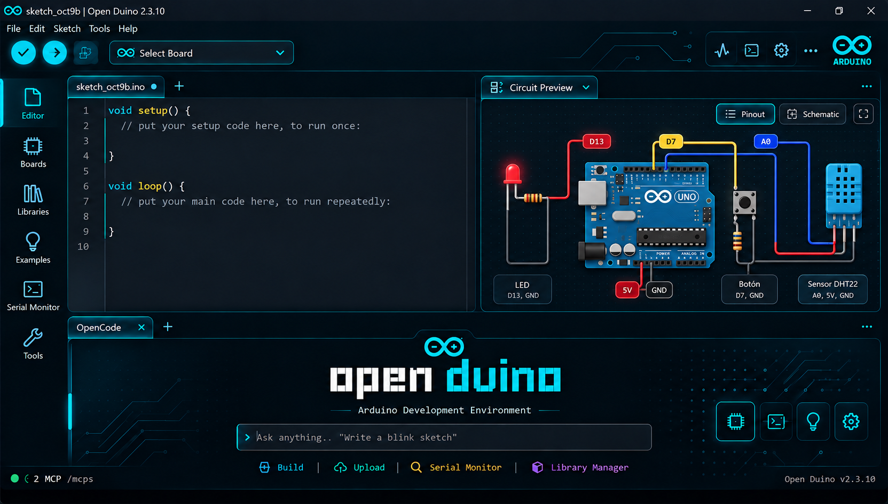

# Open Duino

**Un entorno de desarrollo Arduino con un agente de IA integrado.** Open Duino combina el IDE Arduino 2.x con un servidor MCP integrado para que OpenCode y otros clientes compatibles puedan trabajar con tus sketches, placas y herramientas desde la misma aplicación.



> La imagen es un concepto visual de la interfaz. Open Duino es un proyecto comunitario independiente; no está afiliado, patrocinado ni respaldado por Arduino SA.

[](https://github.com/lanuzadev/Open-Duino/releases/download/openduino-2.3.10-preview.1/open-duino_2.3.10-snapshot-2acf4fa_Windows_64bit.exe)

**Versión de prueba:** `2.3.10-snapshot-2acf4fa` · **Autor:** Lanuzadev · **Repositorio:** [github.com/lanuzadev/Open-Duino](https://github.com/lanuzadev/Open-Duino)

---

## Descargar e instalar

1. Descarga el [instalador para Windows de 64 bits](https://github.com/lanuzadev/Open-Duino/releases/download/openduino-2.3.10-preview.1/open-duino_2.3.10-snapshot-2acf4fa_Windows_64bit.exe).
2. Ejecuta el archivo y sigue los pasos del asistente. Puedes elegir la carpeta de instalación.
3. Abre Open Duino desde el acceso directo del menú Inicio o del escritorio.
4. Conecta una placa Arduino por USB y selecciónala en el menú de placas.

Esta compilación no está firmada con un certificado digital. Windows puede mostrar una advertencia de SmartScreen; revisa que el archivo provenga de este repositorio antes de ejecutarlo.

Open Duino puede instalarse junto al IDE oficial de Arduino. Son aplicaciones distintas y comparten la carpeta de sketches, las placas, las bibliotecas y preferencias de Arduino que usan esos componentes.

## Conectar OpenCode

La integración une OpenCode con el IDE mediante MCP. El agente puede leer y modificar el sketch que tienes abierto y tú puedes ver los cambios en el editor.

1. Instala OpenCode y configura un proveedor de modelos si todavía no lo has hecho.
2. Abre Open Duino.
3. Elige **Help > Connect an AI Agent...**. También puedes pulsar el estado MCP en la esquina inferior izquierda.
4. Copia el comando de **OpenCode** que aparece en el diálogo y ejecútalo en una terminal. El comando se genera con las rutas de esa instalación.
5. Elige **Help > OpenCode Chat** para abrir OpenCode en la terminal integrada, junto al editor.
6. Pídele, por ejemplo: “Crea un sketch Blink para la placa seleccionada, compílalo y explícame el resultado”.

La conexión recomendada usa el puente MCP incluido con Open Duino. Cuando OpenCode solicita una herramienta, el puente puede abrir la aplicación si está cerrada. Se necesita Node.js 18 o posterior. También puedes copiar la configuración manual que muestra el diálogo.

El servidor MCP escucha por defecto en `http://127.0.0.1:3847`. La opción de conexión directa solo funciona mientras Open Duino está abierto; el puente incluido puede iniciar el IDE cuando el agente necesite una herramienta.

### Otros clientes MCP

En **Help > Connect an AI Agent...** encontrarás instrucciones para Claude Code, Claude Desktop, Cursor y clientes compatibles con MCP. El diálogo genera las rutas de la instalación actual; usa esas instrucciones en lugar de copiar rutas de ejemplo.

## Funciones

- Crear, abrir, leer y editar sketches Arduino desde el editor.
- Consultar placas y puertos conectados, seleccionar una placa e instalar núcleos.
- Compilar y cargar sketches usando el mismo toolchain del IDE.
- Leer y enviar datos por el monitor serial, esperar texto específico y detectar reinicios o errores comunes.
- Buscar, instalar y quitar bibliotecas; abrir ejemplos y formatear código Arduino/C++.
- Trabajar con un agente desde OpenCode integrado en una terminal de la aplicación.
- Usar el servidor MCP desde otros clientes compatibles, con herramientas en modo **Router** o **Direct**.
- Cambiar entre los temas claro y oscuro.

Los archivos que modifica el agente se reflejan en el editor. La selección de la placa y los resultados de compilación y carga corresponden al IDE y a las herramientas instaladas en el equipo.

## Privacidad y seguridad de la conexión MCP

- El servidor se enlaza a `127.0.0.1`; no se publica en la red local.
- Las solicitudes requieren un token Bearer generado por la aplicación.
- El token se guarda localmente en `~/.arduinoIDE/mcp-token` (en Windows, dentro de la carpeta del usuario).
- El puente incluido lee el token por ti. No lo compartas ni lo publiques.
- El acceso a archivos del servidor está limitado al sketchbook y a los ejemplos integrados.

## Solución de problemas

### OpenCode muestra `Session failed` o no carga `core/instructions`

1. Cierra la sesión de OpenCode abierta en la terminal integrada.
2. Actualiza Open Duino a la compilación de este repositorio, que incluye el ajuste de ruta de Windows.
3. Vuelve a abrirla desde **Help > OpenCode Chat**.
4. Si el problema continúa, cierra y vuelve a abrir Open Duino y comprueba que OpenCode pueda iniciarse desde una terminal de Windows.

### El agente no encuentra la placa

Comprueba el cable USB, el puerto y la selección de placa. Algunas placas, incluidos ciertos modelos ESP32-S3, no se pueden identificar automáticamente. Pide al agente que use `suggest_fqbn` o selecciona el modelo y el FQBN correctos en el IDE. Puede ser necesario instalar el núcleo desde el gestor de placas.

### La carga falla o el puerto está ocupado

Cierra otras aplicaciones que estén usando el puerto serial. Si el monitor serial del IDE ya está conectado, desconéctalo antes de cargar. Algunas placas que usan USB nativo requieren entrar manualmente en modo bootloader.

### OpenCode no aparece en el menú o no inicia

Instala OpenCode, comprueba que el comando `opencode` esté disponible en una terminal y vuelve a iniciar Open Duino. En **Help > Connect an AI Agent...**, revisa que la conexión aparezca configurada. El puente requiere Node.js 18 o posterior.

## Desarrollo y ejecución desde el código

Para probar cambios de código sin generar un instalador en cada iteración, ejecuta el IDE de desarrollo desde el repositorio.

### Requisitos

- Windows 10/11 de 64 bits.
- Node.js `18.17` o posterior, pero anterior a la versión 21.
- Yarn 4 mediante Corepack (el repositorio fija Yarn `4.5.3`).
- Python 3.9–3.12 y Go 1.21 o posterior.
- Visual Studio 2022 Build Tools con la carga **Desktop development with C++**.
- Git.

### Primera ejecución

Abre PowerShell en la carpeta del repositorio y ejecuta:

```powershell
corepack enable
yarn install
yarn prepare:shims
npm run dev
```

El primer arranque prepara dependencias nativas y compila los componentes de desarrollo, por lo que puede tardar varios minutos. Después abrirá Open Duino directamente desde el código.

### Iteraciones rápidas

Para dejar los compiladores en modo de observación y reiniciar la aplicación por separado:

1. Abre una primera terminal en la raíz del repositorio y ejecuta:

   ```powershell
   npm run watch
   ```

2. Abre una segunda terminal en la misma carpeta y ejecuta:

   ```powershell
   npm run start --prefix electron-app
   ```

Los cambios de frontend se actualizan al recargar la ventana. Para cambios de backend, reinicia la aplicación desde la segunda terminal. Este modo sirve para desarrollo; no crea un instalador.

### Crear el instalador de Windows

Con las dependencias instaladas y los módulos nativos compilados para la versión de Electron del proyecto, genera los bundles de producción y ejecuta el empaquetador desde PowerShell:

```powershell
npm run build --prefix arduino-ide-extension
npm run build --prefix arduino-mcp-extension
node scripts/copy-dev-resources.js
npm run build --prefix electron-app
npm run package --prefix electron-app -- --win nsis
```

El instalador se guarda en `electron-app/dist/`. Los pasos de compilación de producción pueden requerir que los módulos nativos se reconstruyan para Electron. Consulta [la guía técnica de compilación para Windows](docs/BUILDING-WINDOWS.md) si necesitas preparar un entorno desde cero.

## Contribuir

Las contribuciones y los informes de errores son bienvenidos. Abre un [issue](https://github.com/lanuzadev/Open-Duino/issues) para comunicar un problema o crea un pull request con tu propuesta. Indica la versión, el sistema operativo y los pasos para reproducir cualquier error.

## Proyecto y licencia

Open Duino es una versión comunitaria basada en el código abierto de **[Arduino IDE 2.x](https://github.com/arduino/arduino-ide)**. Conserva los avisos de copyright y las marcas de sus autores originales. **Arduino® es una marca registrada de Arduino SA.** Este proyecto es independiente y no está afiliado, patrocinado ni respaldado por Arduino SA.

El repositorio está publicado bajo la licencia **GNU AGPL-3.0-or-later**. Consulta [LICENSE.txt](LICENSE.txt) y los avisos de terceros incluidos con la aplicación.
